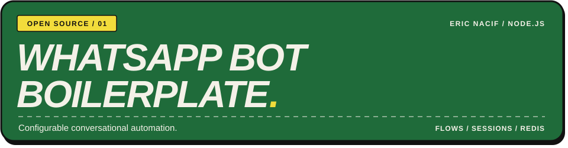
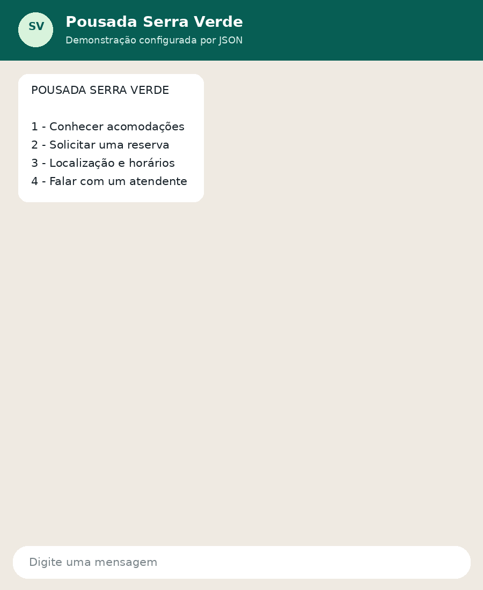
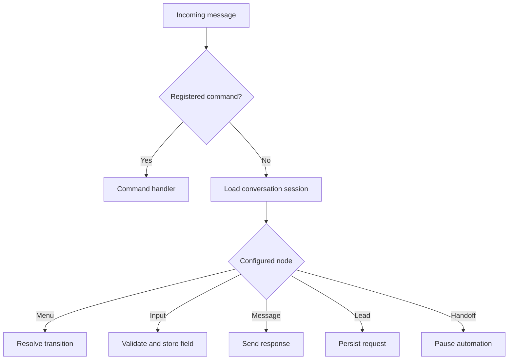

<p align="center">
  
</p>

<p align="center">
  <a href="README.pt-BR.md">Português (Brasil)</a> ·
  <a href="#quick-start">Quick start</a> ·
  <a href="#demo">Demo</a> ·
  <a href="#architecture">Architecture</a>
</p>

# WhatsApp Bot Boilerplate

An open-source Node.js starter for building configurable WhatsApp chatbots, with a declarative conversation engine, per-contact sessions, lead capture and human handoff.

[](https://github.com/ericnacif/template-bot-whatsapp/actions/workflows/ci.yml) [](LICENSE)

Built as a reusable foundation for prototypes, controlled automation and learning. It uses the unofficial WhatsApp Web integration `whatsapp-web.js`; it is not a production-ready WhatsApp Business platform.

## Demo



The fictional Pousada Serra Verde example demonstrates a complete customer journey: browse accommodation, submit a booking request, validate input, save the lead and request human assistance.

Try it without a WhatsApp account or external API credentials:

```bash
npm ci
npm run simulate:pousada
```

Use `/sair` to exit. The demo is in Portuguese and uses the same conversation engine as the WhatsApp client.

[Watch the 32-second demo](docs/demo-pousada.mp4) · [Read the technical case study (PT-BR)](docs/portfolio-case.md)

## Engineering highlights

- **Declarative flows:** define menus, prompts, validation and transitions in JSON rather than rewriting the routing engine.
- **Session abstraction:** choose in-memory storage or Redis, with configurable expiration.
- **Concurrency and abuse controls:** per-contact message queues and rate limiting keep conversation processing ordered and limit flooding.
- **Business workflows:** structured lead capture and a configurable pause for human handoff.
- **Operational readiness:** liveness and readiness endpoints, progressive reconnection and structured logs with message bodies hidden by default.
- **Developer experience:** command registry, reusable validators, local simulator, Docker Compose and automated quality checks.

## Architecture



The router delegates commands and conversation state to a configurable flow engine. Session storage, message queues, lead persistence and health checks are separated from flow definitions.

```text
src/
    commands/       Keyword-based command handlers
    config/         Flow loading and validation
    flows/          Router and declarative conversation engine
    health/         Liveness and readiness endpoints
    middlewares/    Structured logging and rate limiting
    utils/          Sessions, queues, leads and input validation
config/flows/       Default JSON conversation
examples/pousada/   Guesthouse demonstration
scripts/            Local simulation
tests/              Automated tests
docs/               Technical case study and demo assets
```

## Quick start

Node.js 20 is the version configured in this repository and its CI workflow.

```bash
git clone https://github.com/ericnacif/template-bot-whatsapp.git
cd template-bot-whatsapp
npm ci
cp .env.example .env
npm run simulate
```

On Windows PowerShell, use `Copy-Item .env.example .env` instead of `cp`.

To connect the WhatsApp client, run:

```bash
npm start
```

Scan the QR code from WhatsApp's Linked Devices menu. Local authentication is persisted between runs.

### Docker and Redis

```bash
docker compose up --build
```

Docker Compose runs the bot and Redis, with persistent volumes for authentication, sessions and leads. The health server exposes `/health` and `/ready` on port 3000.

For local Redis-backed sessions, set `SESSION_DRIVER=redis` and configure `REDIS_URL` in your environment. See [the example environment file](.env.example) and the [full configuration reference (PT-BR)](README.pt-BR.md#3-configure-as-variáveis-de-ambiente).

## Customize a conversation

Copy [the default JSON flow](config/flows/default.json) and set `BOT_FLOW_FILE` to the new path.

```json
{
    "id": "my-business",
    "initialStep": "menu",
    "triggerWords": ["hello", "menu"],
    "nodes": {
        "menu": {
            "type": "menu",
            "message": "How can I help?",
            "options": {
                "1": { "next": "contact" }
            }
        },
        "contact": {
            "type": "message",
            "message": "Contact us at contact@example.com"
        }
    }
}
```

Supported node types: `menu`, `input`, `message`, `handoff` and `save_lead`. The flow engine also supports reusable validators and message interpolation.

To add keyword-based commands, see [src/commands](src/commands).

## Quality and verification

The v1.2.0 case study documents 52 tests across 14 files. CI runs linting, formatting checks, coverage and a production dependency audit, and builds the Docker image.

```bash
npm run check
npm run test:coverage
npm run audit
```

Coverage thresholds are 75% for statements, functions and lines, and 70% for branches. These are minimum thresholds, not claimed measured coverage.

## Current scope and limitations

- WhatsApp Web automation is unofficial and may break or be restricted. Do not use it for spam or in violation of platform terms.
- The local NDJSON lead store is intended for demonstrations; personal data requires appropriate consent, access controls and retention policies.
- Redis persists conversation state, but does not solve distributed WhatsApp authentication.
- AI integrations are documented as examples, not enabled features.
- Official WhatsApp Cloud API integration, a managed database, an admin dashboard and multi-tenant support are possible future work, not shipped capabilities.

See [the security policy](SECURITY.md) and [full Portuguese documentation](README.pt-BR.md) for additional configuration and operational details.

## License and author

MIT — [LICENSE](LICENSE).

Developed by [Eric Nacif](https://github.com/ericnacif), software developer based in Brasil.

[Portfolio](https://ericnacif.com.br) · [LinkedIn](https://www.linkedin.com/in/eric-nacif/)
